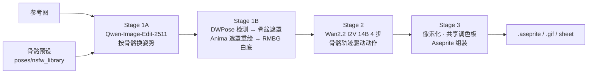

# Aseprite Pixel Animation Pipeline (ComfyUI)

本地成人向像素角色动画管线：**参考图 → 换姿势（Qwen-Image-Edit）→ 局部重绘（Anima）→ 动作视频（Wan2.2 I2V）→ 像素化 → 可编辑 `.aseprite` + GIF + sprite sheet**。全部在本机运行，不需要任何云服务。

> ⚠️ 本项目面向成人内容（NSFW）。工作流默认加载两个 NSFW LoRA；`install.py --sfw` 可跳过它们。



## 需要什么

| 项 | 要求 |
|---|---|
| GPU | NVIDIA，16 GB 显存（RTX 4070 Ti Super 上开发测试） |
| 内存 / 硬盘 | 32 GB RAM；模型约 **62 GB**（不含 NSFW LoRA 约 61 GB） |
| ComfyUI | 0.40+（需要 `LoraLoaderBypassModelOnly`、`RegexReplace` 等较新的内置节点），自带 Python |
| Aseprite | **可选**：生成 `.aseprite` 工程文件需要 Aseprite（Steam/官网版均可，自动探测）；**没有 Aseprite 也能正常导出 MP4 视频、高精度 GIF 动图与 Sprite Sheet 拼图**！ |
| git | 安装脚本用来拉取依赖节点 |

## 安装

1. 把本仓库克隆到 ComfyUI 的 `custom_nodes` 目录下：

   ```bash
   cd ComfyUI/custom_nodes
   git clone https://github.com/Xfire233/aseprite-pixel-anim-comfyui.git
   ```

2. 用 **ComfyUI 自己的 Python** 运行安装脚本（便携版一般是 `python_embeded/python.exe`，秋叶包是 `python/python.exe`）：

   ```bash
   <ComfyUI 的 python> custom_nodes/aseprite-pixel-anim-comfyui/scripts/install.py
   ```

   脚本会依次完成下面四步。每一步都能重复运行，已有的会跳过：
   - 安装 Python 依赖（`requirements.txt`）；
   - 拉取依赖节点：`comfyui_controlnet_aux`（DWPose）、`ComfyUI-RMBG`、RISA Attention、`ComfyUI-WD14-Tagger`；
   - 下载 `models.json` 里的全部模型，支持断点续传，并逐个核对 sha256；
   - 给 ComfyUI 打一个核心补丁（见下文"已知问题"）。

   常用参数：`--skip-models`（只装节点）、`--only-models`（只下模型）、`--sfw`（跳过 NSFW LoRA）。

3. 重启 ComfyUI，把 `workflows/` 里的 JSON 拖进浏览器即可运行。

> 不想跑脚本也可以：工作流里每个模型加载节点都嵌入了下载地址（ComfyUI 原生的 `properties.models`）。拖入工作流后，前端会列出缺失的模型，并提供一键下载。

### RISA Attention（可选加速）

RISA 是一个需要本机 CUDA 编译的 INT8 注意力核（要求 CUDA Toolkit 12.8+、CMake 和 C++ 编译器）。`install.py` 会尝试编译，失败时自动把工作流切换到 `pytorch_attention`：输出不变，只是慢一些。

## 使用

### 网页工作流（`workflows/`）

| 文件 | 用途 |
|---|---|
| `i2i_qwen_edit_wan_aseprite_web.json` | **主工作流**：参考图换姿势 → 动作 → 像素动画 |
| `anima_wan_aseprite_full_web.json` | 同上；Stage 1 用 Anima 直接文生图 |
| `wan_idle_distill_4step_web.json` | 已有角色帧 → 4 步待机动画 |
| `wan_idle_original_web.json` | 同上，不加提示词导演的精简版 |

基本操作：

1. 在 **① 角色参考原图** 节点上传参考图。
2. 在 **NSFW Pose & Motion Library** 节点选骨骼预设，共 10 套（6 套单人、4 套双人）。
3. 在 **LLM Prompt Director** 节点用中文写姿势和动作。默认用本地模板编译，不联网。想用大模型，自己填 `base_url`（任意 OpenAI 兼容接口），再点"获取模型"。
   - **角色卡提取**节点已接在参考图和提示词导演之间：运行时从参考图提取角色卡，写入 `scripts/charcard_<char_name>.json`，并直接替换导演里的 `charcard` 下拉框。只用本地 WD14，不联网；填了 `base_url` 和 `model` 才会调用 LLM 精修。换角色时先改 `char_name`，否则会覆盖旧的卡。想改用下拉框里已有的卡，把提取节点设为 Bypass（Ctrl+B）即可。
4. 运行。开箱默认参数即可直接出图，结果保存在 `ComfyUI/output/`：
   - **高清视频**：`output/phase0/*.mp4`（由 SaveVideo 节点直出）
   - **像素资产**：`output/aseprite/*.aseprite`、4 倍最近邻 `.gif`、`_sheet.png`。

### 想要纯生成 MP4 视频，不接 Aseprite？

完全支持！如果你只想用 Wan2.2 生成高质量的角色动作视频，不需要像素画或 Aseprite：
1. **工作流直出 MP4**：工作流中的 `SaveVideo` 节点会自动把 14B 生成的高清动作视频存为 `.mp4`；
2. **关闭像素化组装**：末尾的 `AsepritePixelizeAssemble` 节点支持 `enable_pixelize` 开关。将其设为 `False`（或选中该节点按 `Ctrl + B` 设为 Bypass），就会直接跳过像素化与组装步骤，零额外开销！
3. **未安装 Aseprite 也能出图**：即使保持像素化开启，如果本机未安装 Aseprite，节点会自动无缝降级为 Python 原生 Pillow 导出高清 `.gif` 动图与 `_sheet.png`，仅跳过 `.aseprite` 工程文件，绝不报错中断！

### 重摇控制（五合一独立局部重摇）

在「提示词导演」或「阶段中继桥」节点底部，已内置快捷重摇套件：
- **🎲 整体全部重摇**：所有阶段全部注入新种子，整张画面与动作完全换新；
- **🎲 仅重摇 Stage 1**：锁死 Stage 2 视频，只重新抽立绘（秒级出静态图，方便挑图）；
- **🎲 仅重摇 Stage 1B**（仅 i2i 工作流）：锁死 1A 原图姿势与构图，只重摇 Anima 局部去衣重绘；
- **🎲 仅重摇 Stage 2**：**锁死上游 Stage 1 立绘（0 秒命中缓存），只让 Wan2.2 重新生成动作视频**！
- **🎲 仅重摇 Pose 动作骨骼**：重新随机生成一套动作骨骼坐标。
*(注：任何节点的采样控制设为 `randomize`（随机）时，系统会在提交瞬间自动刷新为全新 14 位随机种子，绝不锁死旧种子。)*

**调参提示：**
- **衣服没去干净**：点击「仅重摇 Stage 1B」换种子重摇（或改 Stage 1B KSampler 的 seed）。
- **重绘区域偏小**：调大 **Pose Region Mask** 节点的 `size`（默认 1.1~1.4）。
### 命令行（`scripts/`）

需要 ComfyUI 已经启动。

```bash
# 单帧换姿势 + Stage 1B 局部重绘
python scripts/gen.py --ref path/to/ref.png --pose-preset solo_squat_cowgirl \
    --phase "deep squat" --anima-refine --prefix phase0/test

# 首帧 → Wan 动作 → 像素化 → .aseprite
python scripts/wan_gen.py --image first_frame.png --prompt "..." --prefix phase0/idle \
    --pixelize-out work/idle --assemble output/idle.aseprite --zoom work/idle_zoom.png

# 从参考图提取角色卡（纯本地 WD14；加 --base-url/--model 可再用 LLM 精修）
python scripts/extract_charcard.py --image ref.png --name my_char --local-only

# 重建骨骼预设库
python scripts/build_nsfw_pose_library.py

# 改完工作流后检查：连线完整、没写死 LLM 地址或 key
python scripts/validate_workflows.py
```

角色卡格式见 `scripts/charcard.example.json`。生成的 `scripts/charcard_*.json` 不会进 git。

## 所用技术与模型

### 模型（全部由 `install.py` 下载，sha256 已与开发环境逐字节核对）

| 阶段 | 文件 | 来源 | 许可 |
|---|---|---|---|
| 1A 换姿势 | `qwen_image_edit_2511_w4a8.safetensors` (10.8 GB) | [JoaoZaokk/Qwen-Image-Edit-2511-W4A8-ConvRot](https://huggingface.co/JoaoZaokk/Qwen-Image-Edit-2511-W4A8-ConvRot)，基于 [Qwen-Image-Edit-2511](https://huggingface.co/Qwen/Qwen-Image-Edit-2511) | Apache-2.0 |
| 1A 4 步加速 | `Qwen-Image-Edit-2511-Lightning-4steps-V1.0-bf16.safetensors` | [lightx2v/Qwen-Image-Edit-2511-Lightning](https://huggingface.co/lightx2v/Qwen-Image-Edit-2511-Lightning) | Apache-2.0 |
| 1A 文本/视觉编码 | `qwen_2.5_vl_7b_fp8_scaled.safetensors` | [Comfy-Org/Qwen-Image_ComfyUI](https://huggingface.co/Comfy-Org/Qwen-Image_ComfyUI) | Apache-2.0 |
| 1A/1B VAE | `qwen_image_vae.safetensors` | [Comfy-Org/Qwen-Image_ComfyUI](https://huggingface.co/Comfy-Org/Qwen-Image_ComfyUI) | Apache-2.0 |
| 1A NSFW | `Unchained-XXX.safetensors` | [Civitai 2163063](https://civitai.com/models/2163063)，HF 镜像 [smith297/Unchained-XXX](https://huggingface.co/smith297/Unchained-XXX) | 见 Civitai |
| 1A NSFW | `qwen_nsfw_adv.safetensors` | [Civitai 2058077](https://civitai.com/models/2058077)，HF 镜像 [GiorgioV/Qwen-image-adv](https://huggingface.co/GiorgioV/Qwen-image-adv)（下载时改名） | 见 Civitai |
| 1B 重绘 | `anima-base-v1.0.safetensors` | [circlestone-labs/Anima](https://huggingface.co/circlestone-labs/Anima) | CircleStone 非商用（模型卡说明产出可商用） |
| 1B 文本编码 | `qwen_3_06b_base.safetensors` | [circlestone-labs/Anima](https://huggingface.co/circlestone-labs/Anima) | Apache-2.0 |
| 2 视频（高噪） | `wan2.2_i2v_high_noise_14B_int8_convrot.safetensors` (13.5 GB) | [Winnougan/Wan2.2-INT8-Convrot](https://huggingface.co/Winnougan/Wan2.2-INT8-Convrot) | Apache-2.0 |
| 2 视频（低噪） | `wan2.2_i2v_low_noise_14B_int8_convrot.safetensors` (13.5 GB) | 同上 | Apache-2.0 |
| 2 4 步加速 | `wan2.2_i2v_A14b_{high,low}_noise_lora_rank64_lightx2v_4step_1022.safetensors` | [lightx2v/Wan2.2-Distill-Loras](https://huggingface.co/lightx2v/Wan2.2-Distill-Loras) | Apache-2.0 |
| 2 文本编码 | `umt5_xxl_fp8_e4m3fn_scaled.safetensors` | [Comfy-Org/Wan_2.1_ComfyUI_repackaged](https://huggingface.co/Comfy-Org/Wan_2.1_ComfyUI_repackaged) | Apache-2.0 |
| 2 VAE | `wan_2.1_vae.safetensors` | [Comfy-Org/Wan_2.2_ComfyUI_Repackaged](https://huggingface.co/Comfy-Org/Wan_2.2_ComfyUI_Repackaged) | Apache-2.0 |

下面三个由对应节点在首次使用时自动下载：

| 用途 | 模型 | 下载方 | 许可 |
|---|---|---|---|
| 抠图白底 | RMBG-2.0 (BiRefNet) | ComfyUI-RMBG，镜像 [1038lab/RMBG-2.0](https://huggingface.co/1038lab/RMBG-2.0) | **CC BY-NC 4.0（非商用）** |
| 骨骼检测 | DWPose `dw-ll_ucoco_384.onnx` | comfyui_controlnet_aux，[yzd-v/DWPose](https://huggingface.co/yzd-v/DWPose) | Apache-2.0 |
| 角色卡打标 | `wd-vit-tagger-v3` | ComfyUI-WD14-Tagger，[SmilingWolf/wd-vit-tagger-v3](https://huggingface.co/SmilingWolf/wd-vit-tagger-v3) | Apache-2.0 |

### 本仓库自带的节点

| 节点 | 作用 |
|---|---|
| `QwenEditFastConditioning` | Qwen-Edit 条件编码提速：只做一次 504² VL 编码，负面条件置零，参考图 latent 限制在 512，编码完立刻卸载 VL 模型 |
| `AsepriteNSFWPoseLibrary` | 10 套 OpenPose 骨骼预设，外加起点→峰值的动作轨迹 |
| `AsepritePoseRegionMask` | DWPose 关键点 → 骨盆/胸部羽化遮罩。沿"颈→髋"体轴放置，单人、多人、躺姿都适用 |
| `AsepriteLLMPromptDirector` | 中文描述 → Anima / Qwen / Wan 提示词。默认本地模板编译，可选接 OpenAI 兼容接口 |
| `AsepriteCharcardExtractor` | 参考图 → 角色卡 JSON（WD14，可选 LLM 精修） |
| `AsepriteStageBridge` | Stage 1→2 之间释放显存 |
| `AsepritePixelizeAssemble` | 像素化（BiRefNet 抠图、共享调色板、alpha 共识）→ 调用 Aseprite CLI 组装 → 循环质量校验 |

导入本节点时，它还会挂两个运行时补丁（都在 `__init__.py` 里）：
- **显存守卫**：在模型之间切换时清掉残留的 vbar，避免 16 GB 显卡换页卡死。
- **Wan 动作驱动**：选了骨骼预设时，按骨骼段变形首帧生成 9 帧动作轨迹，再交给 Wan 的低噪专家精修，让动作真正跟着骨骼走。

### 关键技术点
- **量化推理**：W4A8 / INT8 ConvRot 权重直接跑 comfy-kitchen 的原生 CUDA 算子；LoRA 走 Bypass 挂载，不做反量化合并。
- **防显存溢出**：所有 VAE 解码都用 `VAEDecodeTiled(256)`，避免 16 GB 卡溢出到 WDDM 共享内存。
- **遮罩重绘**：Stage 1B 只重画遮罩内部分，遮罩外逐像素保留 Qwen 的输出（6 个 seed 实测遮罩外清晰度 ≥0.999）。
- **像素化**：BOX 面积平均缩放；只用前景像素训练 MEDIANCUT 调色板；时序 alpha 共识；乒乓循环。

## 配置

都是可选的环境变量，见 `.env.example`：

| 变量 | 什么时候需要 |
|---|---|
| `ASEPRITE_WF_COMFY_ROOT` | 仓库不在 `ComfyUI/custom_nodes/` 下时 |
| `ASEPRITE_WF_ASEPRITE` | Aseprite 不在 PATH 也不在常见安装位置时 |
| `LLM_BASE_URL` / `LLM_API_KEY` / `LLM_MODEL` | 想用大模型编译提示词时（不设就用本地模板） |
| `HF_TOKEN` | 某个下载返回 401 时 |

在节点里输入的 API key 只保存在本地的 `work/.llm_api_key.secret`，不会写进工作流 JSON；`validate_workflows.py` 会拦截写死了地址或 key 的工作流。

## 已知问题

- **ComfyUI 核心补丁**：同时挂多个 `LoraLoaderBypassModelOnly` 时，后一个会覆盖前一个。补丁在 `patches/comfyui_core_bypass_lora.patch`，`install.py` 会自动打上。升级 ComfyUI 后需要重新运行 `install.py`。
- **Stage 1B 骨盆区细节**：Anima 重画的部分比 Qwen 原图细节少。6 个 seed 测试里，骨盆区清晰度只有 1 个达到原图的 0.67 倍。
- **尚未验证**：双人姿势（`duo_*`）的遮罩与重绘。
- **硬件**：只在 16 GB NVIDIA 卡上测过；其他显存规格可能需要调整分辨率。
- **画面质量**：裸露部位的效果只能人工检查，视觉模型拒绝评价这类画面。

开发记录与决策考古见 `SPEC.md`，给 AI 编码助手的说明见 `AGENTS.md`。
