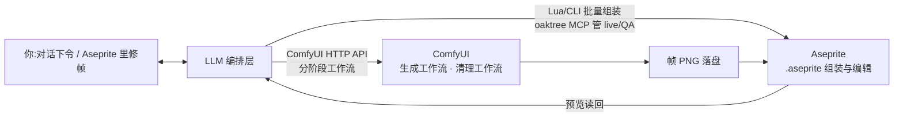

# 像素角色动画工作流 — 设计规格

> 状态:需求已 grill 定稿;介入方式已纸面调研+四路实测对比+live 双向实测,**定选混合:Lua 组装 + oaktree 管 live/QA**(2026-10-14)。
> 目标:参考图(或文字)→ 本地生成基础像素精灵 → 落成可编辑 `.aseprite` → 姿势引导逐帧生成动作帧 → LLM 编排/质检、人工检查点修正 → 导出。
> 内容定位:成人向像素动画。因此**帧生成全本地**(主流云服务禁 NSFW),云仅可用于非敏感的前置参考图。

## 现行定版(2026-10-14,先看这节;下文为调研/实测考古)

- **动作视频生成（现行主力，双入口）**:
  - **入口 A（Web 前端双工作流）**:
    - 文生图→图生视频→Aseprite:`workflows/anima_wan_aseprite_full_web.json`（及 `workflows/wan_idle_distill_4step_web.json`）
    - 图生图换姿→图生视频→Aseprite:`workflows/i2i_qwen_edit_wan_aseprite_web.json`
  - **入口 B（CLI 一键生成+像素化）**:`scripts/wan_gen.py` — Wan2.2 14B INT8-ConvRot 双专家 + LightX2V 4步加速 LoRA（`wan2.2_i2v_A14b_high/low_noise_lora_rank64_lightx2v_4step_1022.safetensors`, `steps=4, split=2, cfg=1.0`）+ `RISAAttention(sparse_int8_attention)` + `VAEDecodeTiled(tile_size=256)`。`384×576×9` 实测 **13.7 秒/段**，`320×480×9` 实测 **12.6 秒/段**。支持 `--loop` / `--end-image`（自动切 `WanFirstLastFrameToVideo` 锁死首尾帧）。
- **像素化+组装**:`scripts/pixelize.py`（洪泛抠图 + 孤立边角噪点剔除 + `--no-register` 视频锁机位裁剪 + `--subsample 4 --pingpong` 抽帧乒乓闭合 + 共享 32 色 + alpha 共识）→ `scripts/assemble.lua` 落 `.aseprite`，并由 `scripts/validate_loop.py` 校验。
- **图生图换姿 / 骨骼引导单帧生成（2026-10-15 W4A8-ConvRot 终极提速定版）**:`scripts/gen.py` 及 `workflows/i2i_qwen_edit_wan_aseprite_web.json` Stage 1 — 采用 `UNETLoader(qwen_image_edit_2511_w4a8.safetensors, 10.79 GiB, comfy-kitchen 原生 asym_w4a8_int8 CUDA 算子)` + `LoraLoaderBypassModelOnly(Qwen-Image-Edit-2511-Lightning-4steps-V1.0-bf16.safetensors)` + `RISAAttention(int8_attention, theta=0.99)` + 自研节点 `QwenEditFastConditioning`（单次 504×504 VL 编码 + 零张量负面条件 + `ref_max_side=512` + 卸载 `Qwen2.5-VL-7B`）+ `VAEDecodeTiled(tile_size=256)`。实测从旧版 **51–75 秒/帧**（及 Q3_K_M 版的 21.0 秒/帧）进一步降至：**`512×768` 冷启动首跑 12.98 秒/帧、热跑换新提示词含 VL 编码 10.70–11.36 秒/帧、同提示词换种仅 2.59–3.22 秒/帧（采样仅 1.5–1.9 秒，`2.09–2.66 it/s`）**。
- **锚帧矩阵**:正面✓ `work/canonical/front_canon_c_fixed.png`;侧面未做。原始插画仅作对照。
- **纪律**:见 `AGENTS.md`(对照门/尝试预算/生成红线/测速口径)。

### ComfyUI 环境维护与 Wan2.2 4步加速定版（2026-10-15）

- 核心升级至 `e0a32bce`（`0.40.0`），嵌入式 Python `3.11.9` + `torch 2.14.1+cu130` + `comfy-kitchen 0.2.37`（CUDA INT8 ConvRot 原生内核已开启）+ `comfy-aimdo 0.5.6` + `xformers 0.0.35 (cu130)` + `RisaAttention 0.2.0`。
- **WanVAE 显存溢出根因与解法**：两个 14B 专家通过 `comfy-aimdo` `vbar` 占用 ~15.2GB 显存，动态模型间切换不卸载 `vbar`（`0 models unloaded`）；非分块 `VAEDecode` 在 `384×576` 下 3D 因果卷积中间特征图超出剩余 ~1.2GB 物理显存，触发 Windows WDDM 共享系统内存换页（68W 卡死 90–260 秒）。改用 **`VAEDecodeTiled(tile_size=256)`** + **`length=9`** 后耗时从 `99.86s` 降至 **`10.77s–13.72s`**。
- **分辨率与帧数定版**：`128×224` 画布下，`320×480`（人物缩 `2.07×`）恰好满足 $\ge 2\times$ `Image.BOX` 面积平均抗锯齿且不糊五官；`length=9` 覆盖单程半周期（92% 运动幅度），抽 4 帧乒乓得 6 帧闭合循环（实测闭合 IoU `0.986`）。
- **Qwen-Image-Edit-2511 16GB 显存四大瓶颈根因与解法**：
  1. 原版双路 `TextEncodeQwenImageEditPlus` 在 `CFG=1.0` 下仍跑两次 8.74GB `Qwen2.5-VL-7B` 编码且把参考图硬编码放大到 `1024×1024` 进 VAE → `QwenEditFastConditioning` 改为单次 504×504 VL 编码、负面直接零化、`ref_max_side=512`、自动写入 `reference_latents_method='index_timestep_zero'`。
  2. `Q3_K_M` GGUF（9.24 GiB）3-bit 权重量化过狠且每步需在 Python 层实时解压回 BF16 → 切换为 `JoaoZaokk/Qwen-Image-Edit-2511-W4A8-ConvRot`（`qwen_image_edit_2511_w4a8.safetensors`, 10.79 GiB，840 层全校准 `asym_w4a8_int8` + `convrot_groupsize=256` 哈达玛旋转），直接走 `comfy-kitchen` 原生 `w4a8_int8_linear` CUDA 内核 + `RISAAttention(int8_attention)`，4 步采样从 GGUF 的 ~12s 降至 **1.5–1.9s（`2.09–2.66 it/s`）**。
  3. 普通 `LoraLoaderModelOnly` 会把 4-bit 权重反量化合并后再重量化（每次重载耗时 ~9s 且引入重量化噪声）→ 改用 `LoraLoaderBypassModelOnly` 保持 BF16 旁路分支（`0 patches attached`），换提示词重载耗时立减 9.1 秒。
  4. `qwen_image_vae.safetensors` 本质是 `WanVAE`，在 `W4A8` 动态 `vbar` 驻留 11GB 显存时跑非分块 `VAEDecode` 会溢出 WDDM 共享内存（卡 55–110 秒）→ Stage 1 同样改用 `VAEDecodeTiled(tile_size=256)`（解码仅 0.4 秒）。
- **2026-10-15 六项深度优化定版（角色一致性 + NSFW 破甲 + 骨骼动作库 + 角色卡提取 + 像素化去杂色）**：
  1. **Stage 1A LoRA 定版配方**：`qwen_nsfw_adv` (0.80) 叠加 `Unchained-XXX` (0.72) + `Lightning-4steps` (1.0) 为中午实测验证通过的黄金脱衣组合；若仅用单 LoRA (0.55) 或将 `qwen_nsfw_adv` 旁路为 0.0，Qwen-Edit 会残留深色牛仔短裤与布料，无法完成脱衣重构。
  2. **Stage 1B 局部精修遮罩与 RegexReplace 防御**：遮罩定版为 `pelvis=True, chest=False, size=1.4, feather=8`，`denoise=0.70`。此前前端由于 `RegexReplace` 的 7 输入与 6 控件值错位，将空正则 `""` 与 `"true"` 传入，导致每字符被注入 `"true"` 产生杂色马赛克；现已在 `__init__.py` 增加核心防护拦截（空正则自动提取 `masterpiece...` 标签，绝不污染提示词），并在工作流 JSON 补齐 7 控件对齐。
  3. **Stage 2 真实 Diffusion 动力学恢复（清除仿射假动作）**：彻底删除底层的 `_warp_image_by_pose_kps` 仿射挤压 hook 与 `_ACTIVE_TRAJ_LATENT` 采样覆盖，严禁“全图局部拉伸”，让 Wan2.2 14B 双专家在 HighNoise (0->2步) + LowNoise (2->4步) 进行真实 Diffusion 动力学运动生成。
  4. **产物元数据双重回溯（PngInfo + workflow.json）**：`AsepritePixelizeAssemble` 声明隐藏上下文 `"prompt"` 与 `"extra_pnginfo"`，在 `_zoom.png` 与 `_sheet.png` 中以标准 `PngInfo` 写入 `prompt` 与 `workflow` 文本块（**直接拖入 ComfyUI 即可 100% 还原全部节点与参数**），同时在 `output/aseprite/` 自动落盘同名 `<name>_workflow.json` 与 `<name>_prompt.json`。
  5. **API Key 密码掩码安全防护**：`web/llm_director.js` 统一拦截 LiteGraph 的 `LGraphCanvas.prototype.prompt` 弹窗输入框为 `type="password"`，画布绘制强制使用 `••••••••••••••••` 掩码，并在 `onNodeCreated` 与 `onConfigure` 同步脱敏，序列化严格存为 `__SAVED__`，绝不向工作流 JSON 或图片元数据泄露明文密钥。同时清理误将 `base_url`/`api_key` 等输入框转成隐藏连线插槽的缺陷，恢复节点上直观的 API Key 输入文本框。
  6. **角色卡提取器开关化与按需智能脱衣（AsepriteCharcardExtractor）**：提取节点新增 `enable_extraction` 布尔开关（默认关闭，不覆盖下拉卡；开启时自动提取）；增加 `user_prompt` 输入插槽由 Vision LLM 智能理解意图——若指令包含脱衣/暴露则完全清洗下装与牛仔面料（`denim` 进入强清洗名单并封入负面词，自适应注入平胸/丰满体型与已知角色名），若指令为普通日常动作则 100% 保持原始服装，不再无差别强行脱衣。
  7. **模块化 LLM 体系、自然语言动作序列生成与 5 大阶段清晰列式布局（2026-10-16 定版）**：
     - **`AsepriteLLMProvider`**：集中管理 API 密钥与端点，向导演、姿势生成器与质检器分发 `LLM_CLIENT` 连接，节点提供原生 `window.prompt` 弹窗输入，彻底杜绝 Canvas 键盘焦点失效 Bug。
     - **`AsepriteLLMPoseGenerator`**：支持自然语言直接生成 OpenPose 18 关键点，内置起止姿态 + 本地人体运动学刚性插值与解剖学比例纠偏（防反折、防脱臼），输出单帧及连续多帧时序序列。
     - **`AsepriteImageCritic`**：工业级多模态打标器（多指/手部完整度、解剖透视畸变、原图面部还原度三项评分），提供 `enable_gate` 熔断门禁。
     - **工作流 5 大阶段清晰重构**：按 `【阶段 0】`、`【阶段 1A】`、`【阶段 1B】`、`【阶段 2】`、`【阶段 3】` 严格横向列式排布，彻底杜绝节点重叠；在 Stage 1A 增加专用 `【阶段 1A 产物预览·重绘前原图】`（Node 62），并在 StageBridge 提供 `🎲 仅重摇 1B`、`🎲 仅重摇 2` 与 `skip_stage2_video` 快速单帧调试开关。
### 坑速查(本机实测)

| 坑 | 对策 |
|---|---|
| `cpu_offload=auto` 慢 18 倍(864s/帧) | 必须 `disable` 全驻留 |
| 三图(image3 链式)间歇爆显存换页卡死 ≥15min | 禁用;双图锚定已够 |
| 标准 LoraLoader 打 SVDQ 权重 = 糊图;pack 1.2.1 无 Qwen LoRA 节点 | 只用融合 Lightning 整模型 |
| GGUF Q4 版 TE+UNet 同驻超显存换页;int8_convrot 32G RAM 加载崩 | GGUF 仅 Q3+Lightning 可用(慢档);主线走 nunchaku |
| ComfyUI 节点缓存使热测假快(18s vs 真实 48s) | 测速换输入、冷热各一 |
| 白衣/白裙高光被抠图洪泛吞掉 | 阈值 ≤12 + 封闭孔洞回填(pixelize.py 已内置) |
| Aseprite CLI `--list-layers/--list-tags` 须置于文件名前 | `-b --list-layers file.aseprite` |
| 模型恒把角色放大至近满高裁脚 | 骨骼占画布高 ~45–56% + 提示词明写留白 |
| 种子方差大(复刻原图构图/编内裤/编过膝袜) | 候选 ≤2 + 对照门逐项验,编造项提示词明禁 |
| DWPose(CUDA onnx)跑过后同会话生成必爆显存换页 | DWPose 独立会话;生成前重启 ComfyUI(每批新开) |
| DWPose 对跪坐/前缩腿误读成长腿站姿 | 复杂坐姿手摆骨骼+文字深度消歧;骨骼占画布 ≤60% 防构图溢出 |
| 逐帧构图抖动:union 裁剪错位涂抹、逐帧 bbox 等高缩放变尺寸脉动(实测首帧被画小 4%) | pixelize.py 剪影配准:逐帧估 (scale,dx,dy) 对齐参考帧(IoU 搜索)→统一 union 裁剪/缩放 |
| 全色共识锁定把少数派帧细节抹成重影(乒乓重复帧带偏多数决,"四帧糊两帧") | 共识只锁剪影 alpha、颜色逐帧保留(pixelize.py `--consensus alpha` 为默认;full 已证有害) |
| Wan 3D-VAE 在 `384×576` 非分块 `VAEDecode` 撞 16G 物理显存墙溢出 WDDM 共享内存(慢 90–260s) | 必用 `VAEDecodeTiled(tile_size=256)` + `length=9` + `320×480`(wan_gen.py 已内置) |
| Wan VAE 首帧四角残留 2–5px 浅灰振铃噪点(`RGB≈240`)撑大裁剪框 | `pixelize.py` `load_rgba` 已内置连通域过滤(剔除 `<64px` 孤立噪点) |
| 固定机位视频跑剪影 IoU 配准会因袖口/头发摆动误缩放制造身高脉动 | 视频源必加 `--no-register`(wan_gen.py 自动启用) |

复盘基建(2026-10-14):管线固化为 `scripts/gen.py`+`scripts/pixelize.py`+`scripts/charcard.json`,纪律见 `AGENTS.md`;GIF 导出定版 4 倍最近邻放大。M 字坐姿压力测试(`phase0/m_sit_b_00001_.png`,手摆骨骼 `poses/m_sit_skeleton_s.png`):2 次尝试内全身入框、腿型拓扑正确、服装/身份对齐;残留=双腿白带(模型先验编造)、布料铺地、小腿未后折(2D 骨骼深度歧义)。结论:姿势拓扑类复杂动作可扩展,返工点在构图(骨骼缩放)与编造小件(对照门拦截);双人遮挡/大转身须先补侧面锚帧+关键帧先行,量产阶段评估角色 LoRA+ControlNet 线(姿势像素级锁定,6–18 秒/帧)。效率账:单帧 51–75s 中 VL 编码约 30s 为最大头,下一步优化=缩输入图(骨骼 512/参考 384)预计降至 ~35s/帧。

## 已定决策

| 项 | 决定 |
|---|---|
| 终点产物 | 可编辑 `.aseprite`(图层+帧+动作 tag);sheet/GIF 为附带导出 |
| 整体架构 | **Agent 编排,零新界面**:ComfyUI=生成/清理后端,Aseprite=编辑界面,对话=指挥界面。不自建 Web 前端,不把整链塞进 ComfyUI 单图 |
| ComfyUI 驱动 | API 无头调用为主(保存 API-format 工作流 JSON,agent 以参数调用);手工调参仍可开界面改图 |
| 画布 | 不再固定(2026-10-14 用户改判):默认**竖版全身 128×224**(`pixelize.py --canvas` 可配,GIF 导出 4 倍);原 160×112 横向废止(角色仅 59px 宽、噪点显眼)。注:角色卡基准细节含"仅左腿(观众右)一条腿环",多余腿环按非定稿侧清除(pixelize `--band noncanon` 默认) |
| 输入 | 参考图优先;文字先文生图得到参考图,再进同一主干 |
| 模板形态 | 先**单人循环**跑通,后双人互动;先做单例,模板资产化待定 |
| 循环帧数 | 6–8 帧/循环 |
| 帧生成机制 | **姿势引导逐帧生成**(姿势引导图 + 角色参考 → img2img/图像编辑 → 像素化清理) |
| 人介入 | 半自动,2 个检查点:①基础精灵定稿 ②每组动作帧生成后 |
| LLM 分工 | 编排、提示词/姿势规划、视觉读回质检、小修、建层/打 tag/导出。**不逐像素执笔** |
| 本地/云 | 帧全本地;云仅限非敏感前置(基础立绘等) |
| 硬件 | RTX 4070 Ti Super 16GB;Aseprite(Steam `C:\Program Files (x86)\Steam\steamapps\common\Aseprite\Aseprite.exe`,会话期间已由 Steam 自动更新至 1.3.18.6);ComfyUI 已部署 |

## 架构



为什么不选另外两种形态:

- **自建 Web 前端**:等于劣化复刻 Aseprite 的像素编辑/onion skin/tag 管理,小项目维护不起;将来真要一键化,在现接口(ComfyUI API + MCP/Lua)上包薄壳不返工。
- **ComfyUI 单图跑全链**:技术上可由自定义节点调 Aseprite CLI/Lua,但无现成节点能写 `.aseprite`;且人工检查点(ComfyUI 中断=取消,不可暂停续跑)与 LLM「看预览→重抽」循环塞不进静态图。
- 检查点与重抽发生在**工作流提交之间**,由编排层控制,这是分阶段的理由。

三段职责严格分离:

1. **生成段(ComfyUI)**:只出 PNG。不碰 `.aseprite`。
2. **清理段(确定性节点/脚本)**:抠图、最近邻缩放到目标网格、调色板量化。风格 LoRA 不保证网格对齐,不靠它做像素化。
3. **文件段(Aseprite)**:批量导入 cel、图层/帧/tag 管理、预览读回、导出。介入方式见下节。

## LLM 介入 Aseprite 的方式(调研结论)

介入方式按阶段分工,不是单选。几乎所有 MCP 的底层都是 Aseprite 官方 Lua API + CLI `--batch`;MCP 的价值在交互与反馈设计,不在"能自动化"本身。

| 方式 | 适用阶段 | 要点 |
|---|---|---|
| MCP 多细工具型(oaktree 139 / Malloy 163 工具) | 组装、质检、(oaktree)live 交互修 | 发现性强、单步可诊断;代价:schema 常驻上下文开销大、工具选择负担 |
| MCP 少胖工具型(Zhang 3 工具:`apply_operations` 事务批量 + `inspect` + 受控 `run_lua`) | 批量组装 | token 最省、事务/回滚语义好;批量导帧无文档化专用 op,待实测 |
| LLM 直写 Lua + `aseprite --batch --script`(无 MCP) | 建文件、组装、导出 | 零第三方依赖、最简维护面;LLM 冷写 Aseprite Lua 的公开成功证据稀疏,必须"生成→运行→读回验"闭环 |
| Live 编辑器桥(Lua WebSocket 扩展 + relay) | 检查点 2:LLM 改打开中的文档 | 唯一支持"人看着、LLM 改未保存文档、改动可 undo"的方式;装配与连接成本最高 |
| AI 扩展(PixelLab/SDDj/AAG) | 生成段素材 | 人用 UI,无证据表明外部 agent 可驱动其扩展 UI/打开文档;不进主链 |
| 直写 `.aseprite` 二进制库 | — | 格式兼容风险,排除 |
| GUI 自动化 | — | 脆弱不可复现,排除 |

### 实测对比结果(2026-10-14,同 fixture:6×160×112 PNG)

四路产物经 Aseprite CLI 独立导出比对,**均为像素级一致(diff=0)、tag/不均时长正确**。区分点在工效学:

| 路线 | 组装调用数 | 批量导帧 | 图像读回 | 量测 QA | 报错质量 | 启动摩擦 |
|---|---:|---|---|---|---|---|
| 纯 Lua(无 MCP) | **1 进程**(冷写脚本一次过) | 脚本内循环导散帧 | 自行 CLI 导出读 PNG | 无(自算) | Lua 原生 | **零** |
| Zhang(3 工具) | 3(批量 op×2+`run_lua` 导帧) | ❌ 无导帧/导出 op,靠逃逸舱 | ✅ `inspect` 回图 | 弱 | 好(前置校验、原子拒绝) | 低 |
| Malloy(163 工具) | 8(sheet 一键建文件+tag+6 时长) | ✅ sheet 一键(散帧需先拼 sheet) | ✅ `render_preview` 回图 | 强 | **最好** | 中(workspace 相对路径沙箱) |
| oaktree(139 工具) | 9(建+导 sheet+6 时长+tag) | ✅ sheet 导存量文件(留空默认层) | ⚠️ 导出到文件再读/像素网格文本 | 强(`qa_sweep`/`frame_diff`) | 最差(裸 Lua 行号) | 中(依赖未锁+backend env) |

Live 实测(oaktree):relay(WS 9877/HTTP 9878)+`claude-bridge.lua` 装入 `%APPDATA%\Aseprite\scripts\` 后,agent 改打开中的文档(品红块落图、可读回)、读回用户手绘像素(151–157,5–9 白色 36 点)、`watch_changes` 计数到改动,均 <0.1s。摩擦一例:live 存盘会触发 Aseprite 模态弹窗致工具超时,需人点掉——检查点 2 流程需预期此类人机交接。

### 定选(混合)与启动配方

- **S2/S4 批量组装**:版控 Lua 脚本 `scripts/assemble.lua`(参数化:`frames/durations/tag/out`,已实测像素完美)。
  `Aseprite.exe -b --script-param ... --script scripts/assemble.lua`(`--script-param` 须在 `--script` 前)。
- **检查点 2 live 协同 + QA 量测**:oaktree。
  headless:`uvx --with "mcp<2" aseprite-live-mcp`,env `ASEPRITE_MCP_BACKEND=headless`、`ASEPRITE_PATH=...`。
  live:先起 relay `uv run --with websockets python bridge/relay_server.py`(桥与 relay 在 oaktree 仓库、非 pip 包内,需 clone 取),Aseprite 内 `File → Scripts → claude-bridge` 连接,MCP env `ASEPRITE_MCP_BACKEND=live`。
- Malloy 为 headless 备选(若 oaktree 维护断档);Zhang 因导帧/导出缺失出局(实际退化为带服务器的 Lua)。

本机备忘:`--list-layers/--list-tags` 须置于文件名之前(`-b --list-layers file.aseprite`),置后无输出;`--save-as` 对多帧文件写 `name1.png..nameN.png`。

## 管线分步

### S0. 参考图入场
- 已有参考图:直接入 `input/`。
- 只有文字:先文生图产出参考立绘(此步可用云,非敏感),再入主干。只维护一条主干。

### S1. 基础精灵生成
- ComfyUI 以 512–1024 生成单角色全身像(大图生成→缩小,优于原生低分辨率生成)。
- 清理:BiRefNet 抠图 → PixelArt-Detector 缩放至目标网格 + 调色板量化(16–32 色起)。
- **检查点 1**:用户确认轮廓、配色、比例;定稿图与其调色板成为后续所有帧的锁定基准。

### S2. 落文件
- 新建 160×112 `.aseprite`:参考层(锁定)+ 绘制层,导入定稿基础帧,写入调色板。

### S3. 姿势引导帧
- 先有 6–8 张姿势引导图(单例阶段:手工粗姿势/由生成图充当;模板化阶段再沉淀为资产)。
- 逐帧:姿势图 + 基础精灵参考 → img2img/指令编辑出帧 → 走 S1 同一清理管线(同网格、同调色板)。
- 逐帧可单独重抽——选此机制而非视频抽帧的核心原因。

### S4. 组装与质检
- 批量导入各帧为 cel,建动作 tag、设帧时长。
- LLM 读回渲染预览/帧间 diff,标记抖动、配色漂移、姿势不可读的帧。
- **检查点 2**:用户在 Aseprite 内(onion skin)修帧;不合格帧回 S3 重抽。

### S5. 导出
- 导出 sprite sheet + GIF;`.aseprite` 为源文件留存。

## 前端生成模型(深度调研 2026-10-14)

### 核心判断:两个活,两类模型

管线的生成段是两个不同任务,不存在一个"最强像素模型"通吃:

| 任务 | 瓶颈 | 首选 | 备选 |
|---|---|---|---|
| S1 角色设计生成 | 动漫质量 + 成人能力 | Anima Base v1.0 / WAI-Illustrious(已装) | Qwen-Image-2512 txt2img |
| S3 同角色换姿势(全管线瓶颈) | 身份保持 + 姿势受控 | **Qwen-Image-Edit-2511**(多图:角色参考+关键点姿势图) | SDXL 角色 LoRA + OpenPose ControlNet |

像素风格不是主要杠杆:无对照证据表明像素 LoRA 胜过"干净动漫图 + 确定性像素化";像素 LoRA 中下载量最大的是 SDXL 的 [Pixel Art XL](https://civitai.com/models/120096/pixel-art-xl)(~10.9 万)。主流实践 = 通用底模 +(可选)像素 LoRA + 像素化清理 + 手工修。

### 像素分支全图谱(Civitai API 实拉,2026-10-14;397 个 pixel LoRA 按版本底模分组)

| 分支 | LoRA 数/聚合下载 | 龙头 | 成熟度判读 |
|---|---|---|---|
| SD 1.5 | 69 / 37 万 | M_Pixel 像素人人(10.6 万)、2D Pixel Toolkit(5.3 万) | 老牌,教程生态最厚(B 站 12 万播放工作流) |
| SDXL 1.0 | 64 / 21 万 | Pixel Art XL(11.9 万) | **唯一有出货证据的分支**(itch 游戏 Blockfall:SDXL+ume_modern_pixelart) |
| Illustrious | **103** / 20 万 | creativehotia 版(5.5 万)、Skormino 版(3.4 万) | 当前最活跃分支;专用 checkpoint Nova Pixels XL(3.1k,NoobAI+IL 混合,NSFW) |
| Pony | 50 / 15 万 | 同上多底模包、Dungeon Squad(1.6 万) | 成人向现成资源多 |
| Flux.1 D | 72 / 8.2 万 | Pokemon Trainer Sprite(1.8 万)、RD Pixel(5.3k) | 有量无王 |
| Z-Image Turbo | 17 / 5 万* | Aziib(Z 版实下载 2,482)、LuisaP Refiner(Z 版 2,177) | *聚合含多底模包重复计;单版本均为千级 |
| Anima | 41 / 3.2 万* | PixelSketcher(Anima 版仅 256)、Aziib(Anima 版仅 120) | 数量涨得快,单品下载仅百级,未验证 |
| Qwen | 8 / 3 万* | PixelArtRedmond(Qwen 版 1,441)、LuisaP(Qwen 版 1,274)、prithivML 2512 LoRA(HF 989) | 千级,仅模型页样例,无生产工作流 |
| FLUX.2 Klein 4B | 2 | Pixel Art Spritesheet – 4-Walk Small(1,212) | **前沿里唯一有真实工作流+失败文档+用户报已做进可玩游戏**;但 BFL 过滤 NSFW,成人不可靠 |
| 其它 | — | Kontext Pixel(1.7k)、Chroma(971)、Wan 像素动画 LoRA(7.6k,视频路线)、Krea2 等 | 零散 |

专用像素 checkpoint(非 LoRA):PixelWave(Flux.1 S,6.7 万)、Pixel Art Diffusion XL(3.4 万)、All-in-One Pixel(SD1.5,1.2 万)、AziibPixelMix XL(SDXL,NSFW)、Nova Pixels XL(IL,NSFW)。共性:只保证"像素风外观",不保证对齐网格——作者(Sprite Shaper)亦明示像素形状会不均。Retro Diffusion 仍为云端 API,无本地权重。

生产证据分级:出货级仅 SDXL 分支一例;重复工作流级:SD1.5 Sprite Sheet Maker(OpenPose+IPAdapter,4.3k)、B 站 All-in-One Pixel 教程链;前沿分支最高仅 Klein 4B 的"早期采用者"级,Qwen 有一例个人工作流(Qwen-Edit 2509 姿势迁移 → SDXL 像素 LoRA 像素化,6 star)——形态与本管线一致,但属 demo 级采用。未找到 DLsite/FANZA 向像素 H 动画的公开生产管线文档。

对 Phase 0 的修正:三臂不变;臂 C 可加测 Nova Pixels XL(IL 分支专用像素 checkpoint)与 WAI+Pixel Art XL 对照。Klein 4B 因成人可靠性问题不进主链,其 spritesheet LoRA 的"512 生成→4× 缩小"配方可借鉴。

### 候选评估摘要

| 模型 | 定位 | 16G | 成人 | 结论 |
|---|---|---|---|---|
| [Qwen-Image-Edit-2511](https://huggingface.co/Qwen/Qwen-Image-Edit-2511) Q4_K_M GGUF(~13.1GB) | 参考编辑:保身份换姿势(官方示例明示),多图输入 | 紧(需 ComfyUI-GGUF) | 无文档化硬过滤,**可靠性未证实,Phase 0 首测** | **S3 首选** |
| Qwen-Image-2.1 INT8 ConvRot | 最新统一生成/编辑 | 可(官方 INT8 工作流) | 未证实 | 挑战者:姿势/一致性实证弱于 2511,不预设更强 |
| [Anima Base v1.0](https://huggingface.co/circlestone-labs/Anima)(CircleStone,基于 Cosmos-Predict2-2B) | 动漫 txt2img,danbooru 标签+自然语言 | 宽裕(2B);LoRA 训练报告 ~10G@512/~14G@1024 | 官方卡含 `nsfw/explicit` 标签 | **S1 首选**;无参考身份编辑,姿势靠实验性 LLLite(弱);**非商业许可**(产出可商用) |
| SDXL 线(WAI-Illustrious v120,已装) | 动漫生成 + 最成熟 ControlNet/LoRA/IPAdapter 生态 | 宽裕 | ✅ 确定 | 基线/兜底;单参考图身份弱,角色 LoRA 需多图数据集 |
| FLUX.1 Kontext(已装)/ FLUX.2 Klein 4B | 指令编辑 | 紧/可 | 训练数据过滤 NSFW,可靠性不稳 | 非成人帧主力 |
| Z-Image Turbo | 快速 txt2img | 可 | 未证实 | Edit 未发布,出局(主链) |
| FLUX.2 dev / Klein 9B / Seedream | — | 超显存 / 云端 | — | 出局 |

合成打法:Qwen-Edit 从单参考图产多姿势变体 → 作数据集训角色 LoRA(Anima/WAI)→ 生产帧在动漫底模 + 姿势控制上跑。编辑模型解决冷启动数据集,动漫底模解决画风与成人可靠性。

本地库存(秋叶整合包):已有 WAI-Illustrious v120、WAI-Pony、FLUX.1 Kontext(nunchaku)、Wan 系列;缺 Qwen-Image-Edit-2511 GGUF+编码器/VAE、Anima、Pixel Art XL、SDXL OpenPose ControlNet、ComfyUI-GGUF 与 PixelArt-Detector 节点。

### Phase 0 实测协议(下一步)

同参考图 + 同组姿势(关键点图),三臂各出 6 帧 → 同一清理管线像素化至 160×112 → 在**最终尺寸**盲比:身份可辨识度、姿势跟随、调色板漂移、单帧耗时、操作摩擦。

1. 臂 A:Qwen-Image-Edit-2511 Q4_K_M(角色图+关键点图多图编辑)。第一测:成人内容可靠性,不达标先找社区 NSFW LoRA/微调,再不行降级。
2. 臂 B:Anima Base(像素 LoRA 开/关各一组,兼答"像素 LoRA 是否必要")+ LLLite 姿势。
3. 臂 C:WAI-Illustrious + Pixel Art XL + OpenPose ControlNet(零下载基线)。

清理节点:[ComfyUI-PixelArt-Detector](https://github.com/dimtoneff/ComfyUI-PixelArt-Detector)(缩放/调色板)+ BiRefNet 抠图。

### Phase 0 实测结果(2026-10-14 执行,4 姿势版)

| 臂 | 身份一致性 | 姿势跟随 | 像素化后可读性 | 速度 | 结论 |
|---|---|---|---|---|---|
| A:Qwen-Image-Edit-2511 Q3_K_M GGUF + Lightning-8steps LoRA | **最强**(同脸/发型/服装;成人内容如实复现,无审查变形) | 站/走/跪准确,坐近似 | 好;身形瘦长脸部像素少(S1 设计头身比需偏 Q) | 84 秒/帧 | **S3 主力定版** |
| B:Anima Base v1.0 txt2img | 一般(同类非同一人;头身比漂移;跪姿出双人) | 提示词级 | 最干净(大色块) | 18 秒/帧 | S1 设计/身体基准生成 |
| C:WAI-Illustrious + Pixel Art XL(±OpenPose CN) | 弱(漂移+小人伪影+脏块;CN 跪/坐失败) | 差 | 原生像素感强但脏 | 6–9 秒/帧 | 淘汰 |

附带结论:像素 LoRA 非必需(干净图+确定性像素化不输)。证据:`work/phase0/contact_sheet.png`、单帧 `work/phase0/pixel/`。

臂 A 定版配方:`UnetLoaderGGUF(qwen-image-edit-2511-Q3_K_M.gguf)` + `LoraLoaderModelOnly(Qwen-Image-Edit-2511-Lightning-8steps-V1.0-bf16, 1.0)` + `CLIPLoader(qwen_2.5_vl_7b_fp8_scaled, qwen_image)` + `ModelSamplingAuraFlow(3.1)`;8 步/CFG 1.0/euler/simple;画布 768×536,参考图 ≤512,骨骼图占画布高 ~70% 防裁头;ComfyUI `--lowvram` 启动。已知坑:Q4_K_M GGUF 本机 120–600 秒/步(TE 与 UNet 同驻超显存走 WDDM 换页);int8_convrot 原生权重在 32G RAM 加载期内存提交爆(AccessViolation);GGUF 版 VL 编码器与 mmproj 维度不匹配。模型文件已装入秋叶包 models 目录;ComfyUI-GGUF 与 PixelArt-Detector 节点已装。

正面视角实测(2026-10-14,6 帧站姿循环,`output/front_loop.aseprite`):正面身份保持同样强(脸/眼镜/蝴蝶结正对镜头稳定),双腿分开站姿可读;问题:① 模型恒把角色放大至近满高,骨骼需缩至画布高 ~56% 才保住脚入框;② 和服长度随姿势漂移(长款遮腿 vs 短款),服装一致性弱于侧面。速度账:稳态 84 秒/帧(768 画布/8 步),其中双图编码+模型换页 ~50 秒为固定开销,采样仅 ~4–5 秒/步;4 步 Lightning+640 画布实测 68 秒/帧,提速有限且构图易裁脚。单循环(6–8 帧)生成预算约 8–11 分钟。

nunchaku 提速实测(2026-10-14):已升级 wheel 0.3.1→1.0.1+torch2.7、节点包 0.3.3→v1.2.1(旧版备份在秋叶包根目录 `ComfyUI-nunchaku-0.3.3.bak`);Flux/Kontext 老节点保留。定版新配方:`NunchakuQwenImageDiTLoader(svdq-int4_r128-qwen-image-edit-2509-lightningv2.0-4steps, cpu_offload=disable)` + 同 TE/VAE + 4 步/CFG 1.0,无 LoRA 节点(融合 Lightning)。实测:冷启动首帧 36 秒、新姿势帧 48 秒/帧(双图 TE 编码 ~30 秒成主成本,采样仅 ~15 秒),比 GGUF 84 秒快 1.75×,画质/身份与 2511 GGUF 相当(证据 `bench_2509_f3_00001_.png`)。坑:① 标准 LoraLoaderModelOnly 与 SVDQ 不兼容且 pack 1.2.1 无 Qwen LoRA 节点,只能用融合模型;② `cpu_offload=auto` 在本机灾难性慢(QuantFunc 实测 864 秒/帧),必须 disable 全驻留;③ tonera 社区融合版键名与 wheel 1.0.1 不匹配已弃用删除,QuantFunc best_quality(无 Lightning)保留作高质量慢速档。待机循环实测:`output/idle_loop.aseprite` 6 帧同种子+2–3px 骨骼位移,剪影相邻 IoU 0.90–0.94、闭环 0.944,剪影稳但细节微闪、呼吸幅度小(骨骼位移需放大)。像素化修正:裁剪后必须等比缩放+底部居中贴图,禁止直接拉伸至 160×112。

### 一致性方法(2026-10-14 实测确立)

帧间一致性(v3 待机,`output/idle_loop_v3.aseprite`):独立逐帧生成必闪(手部在终图仅 3–4px,模型逐帧现编),定版组合四件套:① 骨骼冻结不动点(待机手腕/肘全程同坐标,只动肩/胸/头;位移需放大至终图 ≥1px 即源尺度 ~8px);② 乒乓循环(只生成半程 3 帧,f1→f2→f3→f2 组装,生成减半+闭环构造完美);③ 链式前帧锚定(前帧成品缩至 384 宽喂 image3+提示"服装/手型与前帧完全一致";注意 640 宽锚图+768 画布会爆显存换页卡死,384+640 画布实测 70–78 秒/帧);④ 提示词常开"mitten hands/no visible fingers"+服装锁定词条逐字复用。后处理定版:全帧共享调色板(禁止逐帧量化)+时序一致性锁定(≥3/4 帧同色像素锁定);抠图洪泛阈值 ≤12 且必须封闭孔洞回填(白裙高光会被洪泛吞掉)。帧间变化像素:v1 独立生成 4029 → v2 仅后处理 2435 → v3 全套 2432(角色更大 61px 宽,等效更优,且手位构造冻结)。

跨视角服装一致性(用户指出:侧面服装被模型编造、与正面冲突):根源是单视角参考下模型对未见视角的服装自由发挥。定版方法="锚帧矩阵"——S1 定稿产出 `视角{正面,侧面} × 服装状态{...}` 每格一张人工确认的像素定稿(检查点 1 在 Aseprite 修准)+文字角色卡(服装锁定词条、不对称配饰位置);此后所有动作生成锚定对应格定稿(不用原始插画直生动作),服装状态成为动作模板的显式参数;定稿积累后训角色 LoRA 固化(Anima/WAI 线)。

角色卡(自 `input/139987119_p0.png` 摘录,2026-10-14 与用户对齐):粉色短 bob、刘海遮右眼、紫瞳细圆眼镜、头左侧(观众右)白金缎带蝴蝶结、金项圈方坠;**基准服装状态=不齐整**:白色和服滑落双肩挂于肘部、胸前敞开、宽金腰带花扣、腰下仅短白布至大腿根、光腿、透明凉鞋。教训与规则:提示词禁止写入与参考图状态冲突的服装描述(此前误写 "closed/fully covering+长裙" 导致正面被穿齐整,`idle_loop` v1–v3 及 `front_loop` 均为错误状态的管线验证品、资产作废);服装锁定词条必须逐字抄录角色卡,生成后必须与参考图三方对照(参考/新图/旧图)逐项核对才许入锚帧矩阵。正面定稿候选:`work/canonical/front_canon_c.png`(对照图 `work/canonical/compare_ref_C_oldclosed.png`);已知残差:和服侧摆拖地(待像素检查点手修)、凉鞋未入框、左大腿浅带伪影、体型略瘦于原图。迭代经验:抽种子方差大(跪姿复刻/内裤/过膝袜皆为模型编造,须提示词明禁且逐项验);单图编辑删拖尾会放大裁切构图,不可用。
正面待机 v4(2026-10-14,`output/idle_loop_v4.aseprite`):以定稿 C(源图程序擦除拖地侧摆版 `front_canon_c_fixed.png`)裁剪图为唯一角色参考(原始插画退役),同种子三帧(s1/s2/s3 冻结手腕骨骼)+乒乓组装;服装状态与参考对齐。经验:① 定稿原图不可直接作循环帧(与生成帧尺度不一致会被共识锁定碾碎),须同批生成;② 链式三图(image3)在本机间歇爆显存换页(≥15 分钟),双图(定稿裁剪+骨骼)锚定已够、51–63 秒/帧稳定;③ 每帧生成设 240 秒硬超时自动中断。残留:右大腿 1px 亮线(腰布下缘,可接受)、凉鞋以底行金色像素代替、体型略瘦。帧间变化像素 1533(历代最低:同批同尺度+共享调色板+共识)。

## 目录布局(拟)

```
input/            参考图
work/<角色>/       中间产物:原始生成图、清理后帧、调色板
output/           <角色>.aseprite + sheet/GIF 导出
comfy/            ComfyUI 工作流 JSON(生成/清理各一份,API format)
poses/            姿势引导图(单例起步,后续模板资产)
scripts/          Lua 组装脚本(若无 MCP 路线入选或作兜底)
SPEC.md           本文件
```

## 明确不做(及依据)

- **LLM 逐像素执笔**:已有 Aseprite 工具调用绘画实验([Draw me a swordsman](https://ljvmiranda921.github.io/notebook/2025/07/20/draw-me-a-swordsman/)),最佳结果仅"可看",作者亦不推荐;批量导入 cel 才是正道。
- **视频生成抽帧**:角色漂移/肢体崩坏不可逐帧修正,与"可编辑"冲突。
- **云端帧生成**(PixelLab/Retro Diffusion/Scenario):成人内容不可用,导出多为扁平 sheet。PixelLab 骨骼动画思路可作非敏感动作参考,不进主链。
- **自建 Web 前端 / ComfyUI 单图全链**:见架构节。

## 主要风险

1. **跨帧一致性**(最高):扩散逐帧重绘必然漂移。缓解:同种子/低 denoise、参考约束、调色板硬锁、检查点 2 人工修。接受"生成 80%、人工修 20%"为常态。
2. **MCP 成熟度与依赖纪律**:候选均为小众社区项目;oaktree 已实测出未锁依赖崩溃。缓解:启动命令锁版本、Lua/CLI 兜底、实测对比定选。
3. **Qwen GGUF+LoRA 未验证**:Phase 0 先验 LoRA 能否加载;失败则 Qwen 降级或出局。
4. **双人阶段接触/遮挡一致性**:v1 不攻。

## 现成工作流参考(调研摘要)

无现成一站式方案覆盖本链。可借鉴碎片:[PixelLab + Aseprite](https://www.pixellab.ai/docs/tools/animate-with-skeleton)(参考+骨骼→帧,云)、[SDDj](https://github.com/FeelTheFonk/SDDj)(本地 SD+Aseprite 桥接)、[Sprite Sheet Diffusion](https://arxiv.org/abs/2412.03685)(参考+姿势引导扩散,研究代码)、[ComfyUI-GameAssetsMaker](https://github.com/quinteroac/ComfyUI-GameAssetsMaker)(Aseprite 兼容 atlas JSON/预览,不写 `.aseprite`)。

## 下一步

1. ~~实测对比 + 定选介入方式~~(已完成:混合定选,见上)。
2. ComfyUI 两份工作流 JSON(生成/清理,API format)+ Phase 0 模型 A/B(SDXL vs Qwen GGUF)。
3. 单例单人循环端到端跑通 → 评估模板资产化与双人阶段。

### 全新一轮实测(2026-10-14 下午,无下摆+肉色过膝袜版 idle,output/idle_loop_v6.aseprite)
- 角色卡 v2 `scripts/charcard_nude.json`(无下身衣物)+ 参考图须紧裁人物(`ref_char_crop512.png`):全画幅/定稿 C 作 image1 会把原图莲花座 token 带进生成(脚下生莲、衣摆回归),紧裁后消失。
- 「无下身衣物」生成命中率仅约 4/10(内裤/布片/跪姿跑偏),靠固定 seed 链不行,必须逐帧原图目检清单+重抽(暖缓存 15s/抽可接受)。
- 新增帧间一致性校验 `scripts/validate_loop.py`(bbox/IoU/腰带Y/脸锐度/袜口 dip 检测,FAIL 退出码 1),定稿前必跑;袜口高度生成侧漂 ±4px,pixelize `--stocking-tint` 现含袜口规范化重绘(中位高度)+白袜身染肉色。
- 计时:整轮 31 分钟(13:31→14:02)含校验器/染色开发与 5 次重抽;纯生成约 8 分钟(13 抽)。管线本身(像素化+校验)3 秒。

### v7 修复轮(2026-10-14 下午,output/idle_loop_v7.aseprite;用户三诉:下体细节缺失/帧间晃动光影跳/袜口白条)
- 下体细节:Qwen-Edit 全身构图自我审查画光滑裆,提示词直说无效。Civitai 调研后实测(GGUF Q3 栈):NSFW_Adv.1 会带回裙子淘汰;Unchained XXX(Edit2509)Lightning 下被稀释、全配方(20步CFG3.5)全身仍光滑;**局部重绘有效**:裁裆部放大单独 Edit(GGUF+Unchained 全配方)→质心对齐椭圆羽化贴回,已固化 `scripts/crotch_refine.py`(锚点=大腿间白间隙顶端;-10px)。SexGod(2511,需叠 unblur LoRA,照片向)未测留作后手;QWEN 4PLAY(体位 tag)留作双人模板候选。
- 连贯性:三帧不同 seed 独立抽 = adj-diff 13878;改**两图链**(上一帧缩短边 384 作 image1+骨架 image2,同 seed,nunchaku 栈,gen.py --ref)后 adj-diff 6406、IoU 0.98+、服装遵循零重抽。校验器新增 adj-diff coherence 检查(默认 ≤9000)。
- 袜口:重绘改肉色蕾丝(逐像素保明暗的 beige 池+底行深边),不再平涂纯白;链式后袜口自然漂移仅 ±1px,规范化基本无-op。校验器袜口检测改 bbox 相对区+亮度阶跃签名。
- RisaAttention(用户荐，升级前记录):nunchaku 栈绕过 set_model_optimized_attention 钩子，GGUF 栈当时瓶颈在模型换入；当时 Windows 未嵌入。**本轮维护已在 Windows 编译并完成真实 CUDA 运算验证**，当前状态见顶部「ComfyUI 环境维护」。
